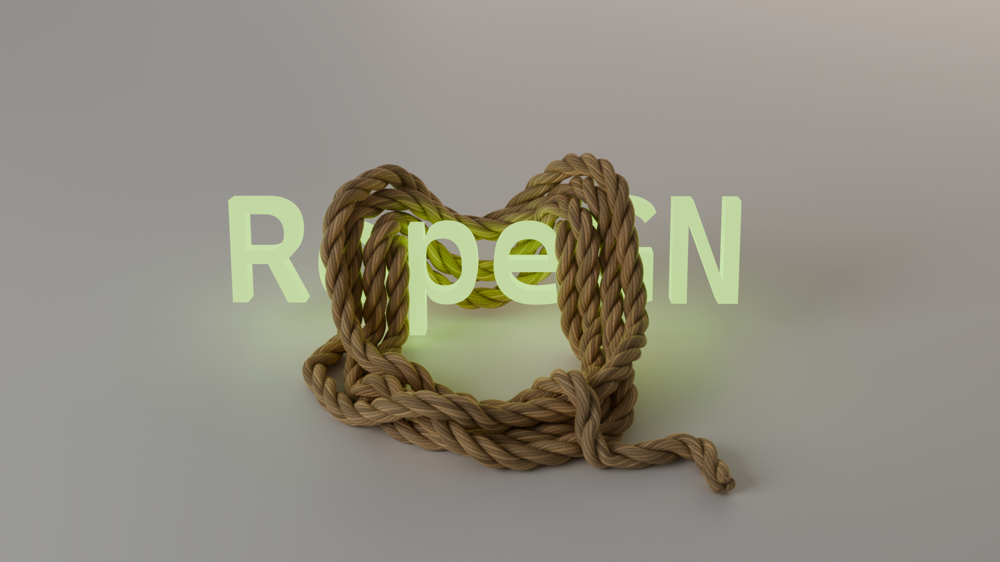

A (growing) collection of useful geometry node groups for Blender for all sorts of things.

# Installation

Unzip the corresponding `<GN>.zip` (download from the releases) into any directory indicated in your "Asset Libraries" settings. If you don't have any directories there, just create one: Preferences -> Asset Libraries -> Add Asset Library -> Add Local Asset Library.

> Alternatively, you can just download the `.blend` file from this repository and Append the geometry node group into your project.

# Usage

After installing, the node group should appear in the `Shift+A` menu in Geometry Nodes editor and in the Add Modifier menu.

### RopeGN

