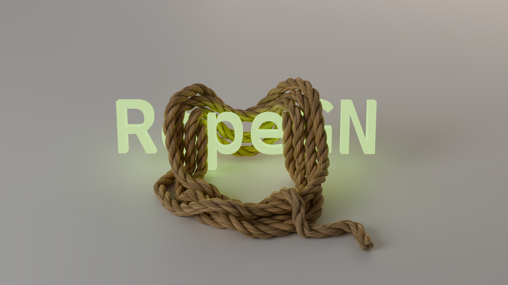
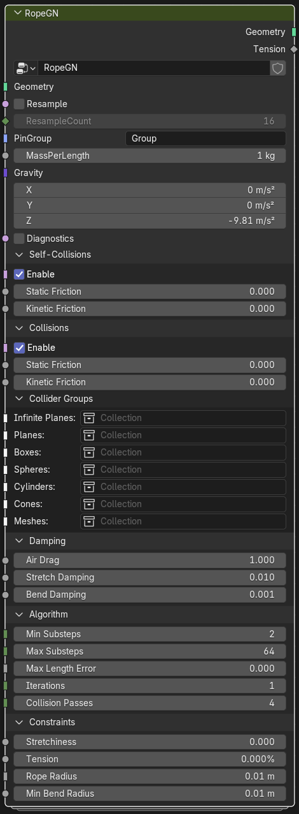
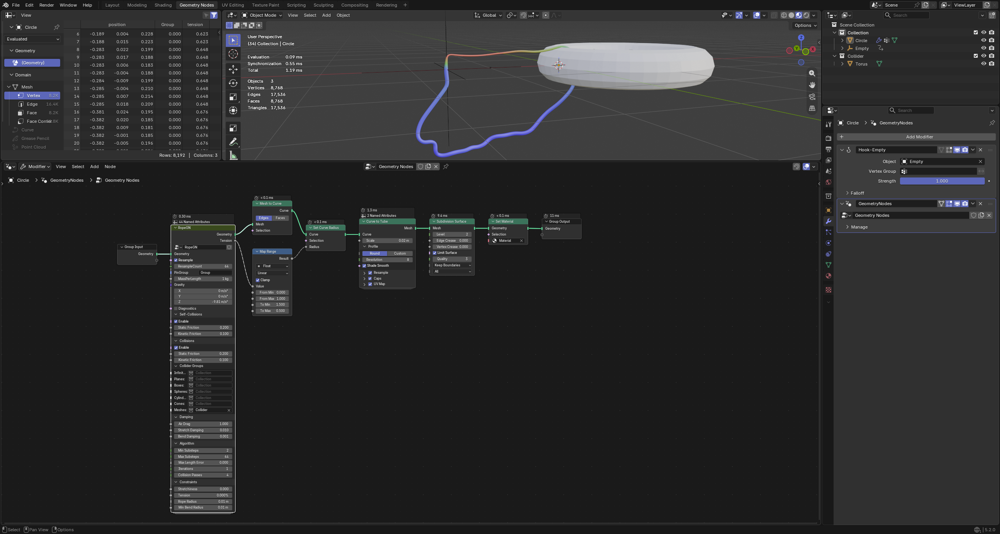
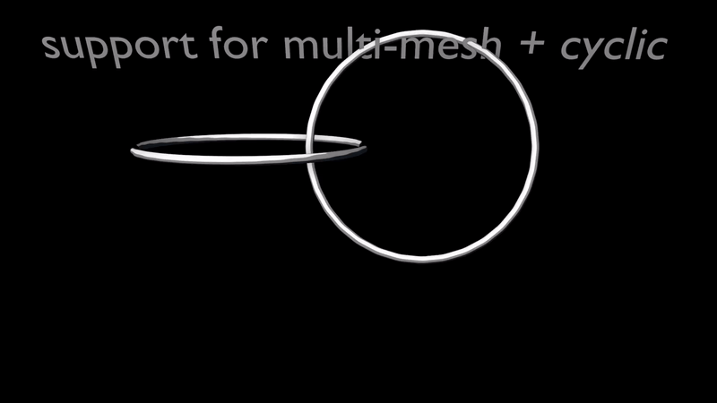
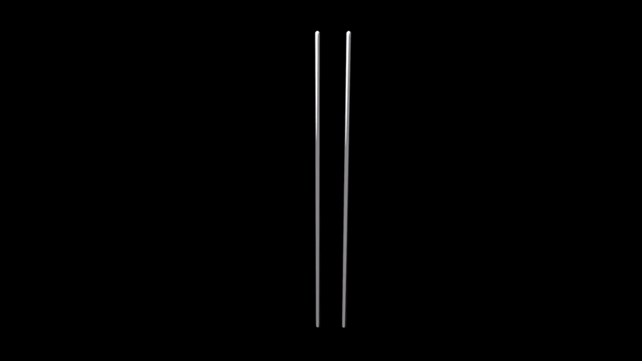
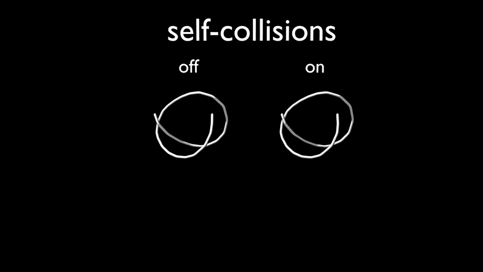
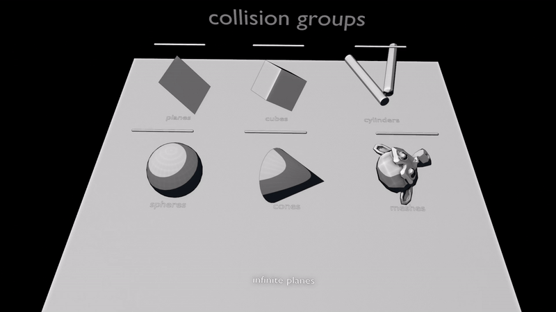
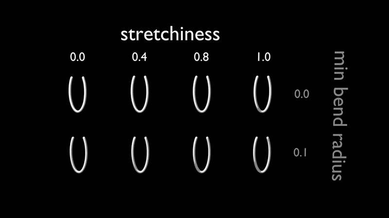
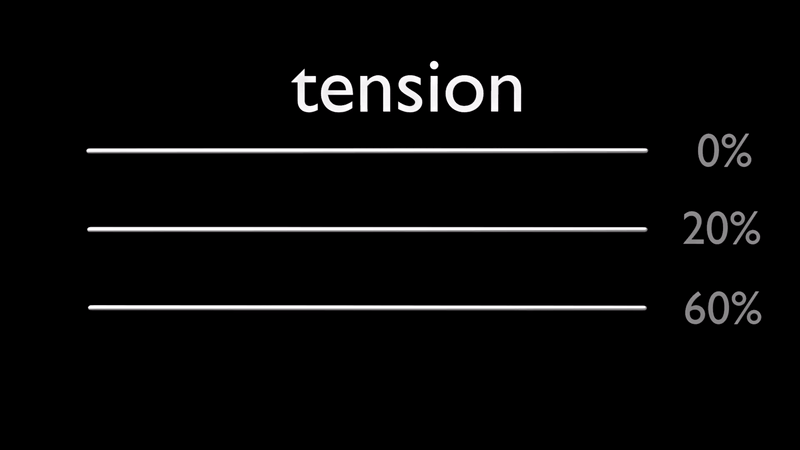
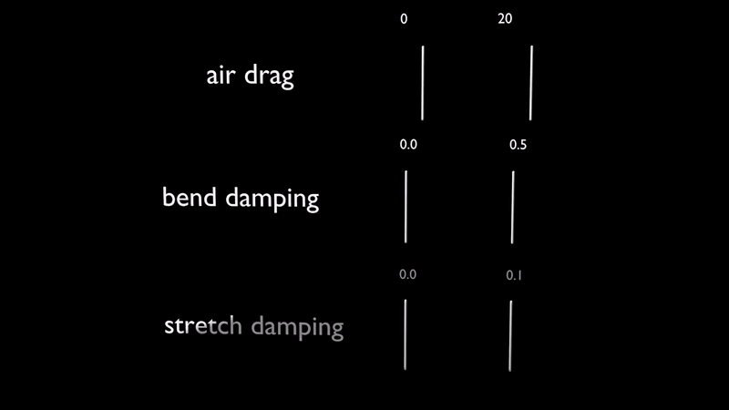

# RopeGN

### Why?

Blender doesn't provide a built-in simulation capabilities for 1D objects such as ropes. One could fake that with a narrow-mesh cloth simulation, but the result is not good enough.

### How?

RopeGN implements the [XPBD](https://developer.blender.org/docs/features/nodes/xpbd_solver/xpbd_method/) algorithm (also used in Blender's cloth simulation) with some tweaks and sauces specific to 1D manifolds which makes it more effective, accurate and much faster.

### Cool features

- pin groups for fixed points
- control over the (pre-)tension of the rope (pin points supply constant prescribed tension)
- support for interaction of multiple rope segments as well as closed loop ropes
- accurate self-collisions and external collisions
- different kinds of dissipation (drag, damping, friction)
- adaptive substepping when high accuracy is needed
- export per-segment tension attribute

|  |  |
|---|---|
| Geometry Node group | Usage example |

### Demos

### Collisions

## Effects of different parameters

